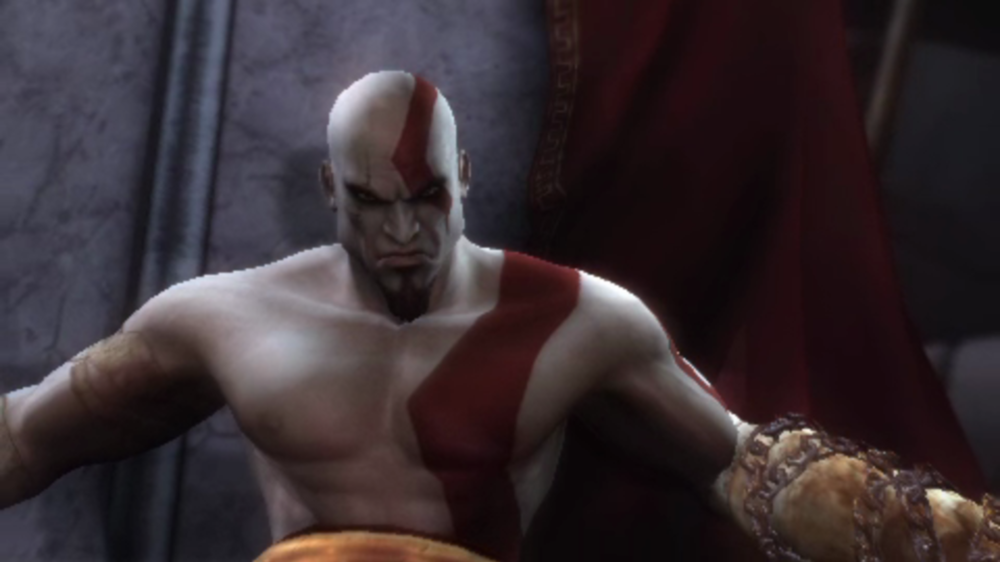

  

<h3 align="center">Game Vault · PPSSPP</h3>

  <b>PSP games on your Xbox, with the controller.</b> 
  The PPSSPP emulator for <a href="https://github.com/skitzellez/xbox-game-vault">Game Vault</a> on <b>Xbox Series X|S</b> in Dev Mode:
  pick a game in Game Vault and it plays here, then you are back in Game Vault.

<!-- gv-buttons:start -->

  
  &nbsp;
  
  &nbsp;
  
  &nbsp;
  

<!-- gv-buttons:end -->

  

## 🎮 What it is

[PPSSPP](https://www.ppsspp.org) is the free, open-source PSP emulator by Henrik Rydgård and the PPSSPP team. This app is PPSSPP 1.20.4 made as its own Xbox app for Game Vault, so Game Vault can install it, keep it up to date and start your PSP games in it.

No games are included. Only play games you have the right to play.

## 1️⃣ 2️⃣ 3️⃣ How to play

| | |
|---|---|
| **1** | Install [Game Vault](https://github.com/skitzellez/xbox-game-vault). Press RT in Game Vault to add this app with your phone. |
| **2** | Copy your PSP games (`.iso` or `.cso`) onto your games USB drive. |
| **3** | Open the **PSP** shelf in Game Vault and press A. Quit the game in PPSSPP to go back to Game Vault. |

## 📜 Credits and licence

This app is the work of many people. Thank you to all of them.

- **PPSSPP:** © Henrik Rydgård and the [PPSSPP team and contributors](https://github.com/hrydgard/ppsspp/graphs/contributors). GPL-2.0 or later, see [LICENSE.TXT](LICENSE.TXT). The original readme is in [README-PPSSPP.md](README-PPSSPP.md).
- **PPSSPP's Windows app (UWP) and Xbox port:** the PPSSPP team and its UWP contributors.
- **Other libraries** (FFmpeg, SPIRV-Cross, glslang, zstd and more): see the `ext` folder and its licences.
- **Game Vault app and launch from Game Vault:** Skitzelles.

This is a modified build of PPSSPP, not made or supported by the PPSSPP team. Please report problems with this app to Game Vault, not to them.

The full source of this build is this repository (branch `gamevault`).

<!-- gv-family:start -->
<!-- gv-family:end -->
## ❤️ Support the project

Game Vault and all of its emulator builds are free, and they always will be. No ads, no locked features,
nothing behind a paywall.

I build all of this with the help of an AI coding assistant (Claude), and that's what lets bug fixes and new features
come out so fast. If you'd like to help keep it going, you can support the project on
**[Patreon](https://www.patreon.com/Skitzelles)**. Every bit helps, and there's never any pressure.

**You help just as much by:**
- saying yes to **"Help make Game Vault better?"** in Game Vault. It sends crash reports, and that's how most fixes happen
- reporting problems on the **[Discord](https://discord.gg/RmhhWgguvw)**
- telling your friends and sharing your clips

Thank you for playing. 💙
